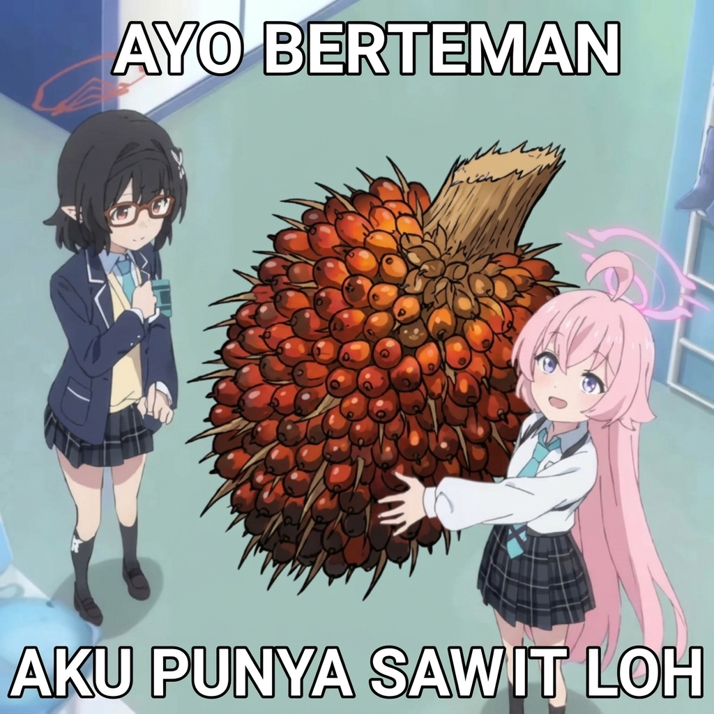
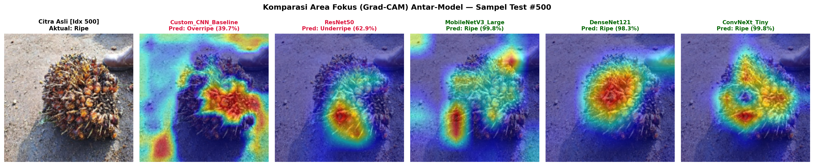
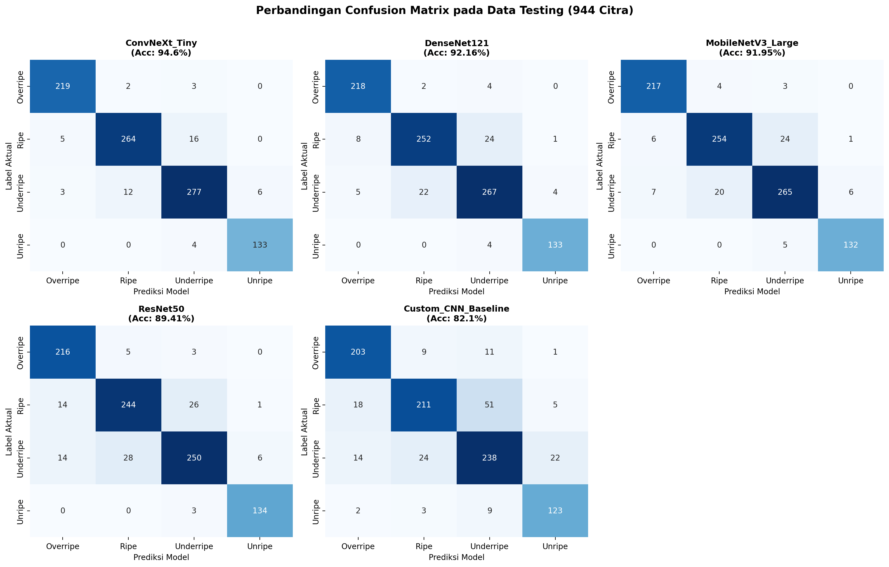
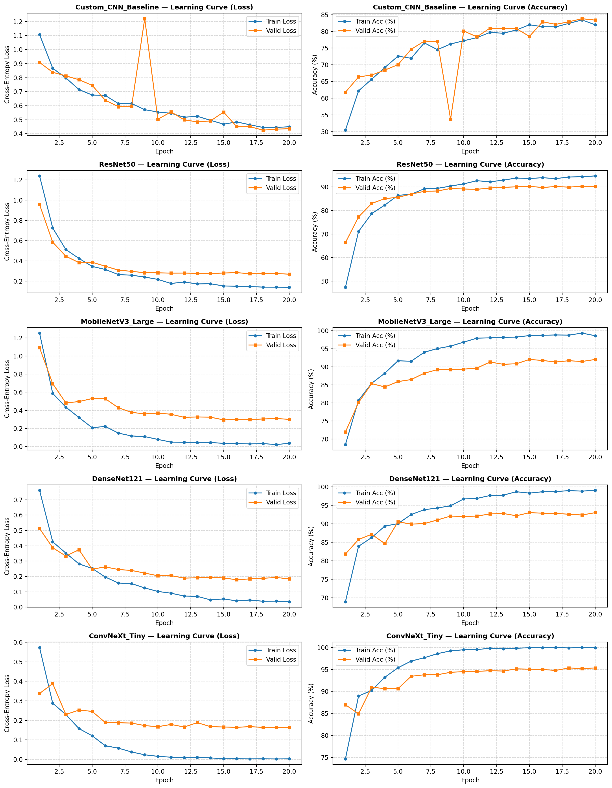
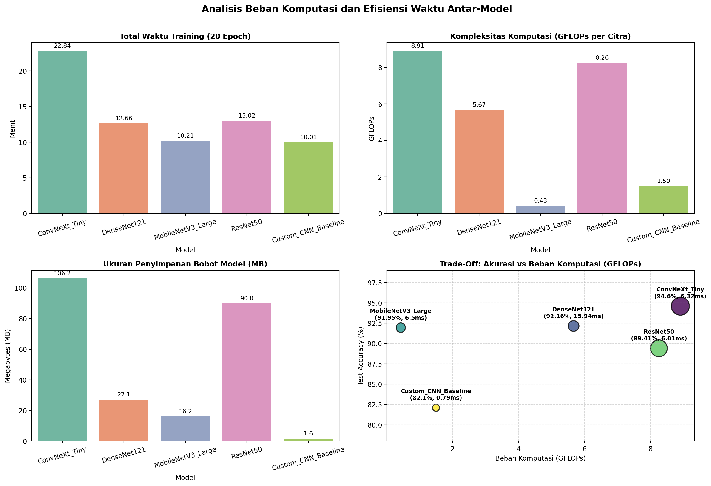
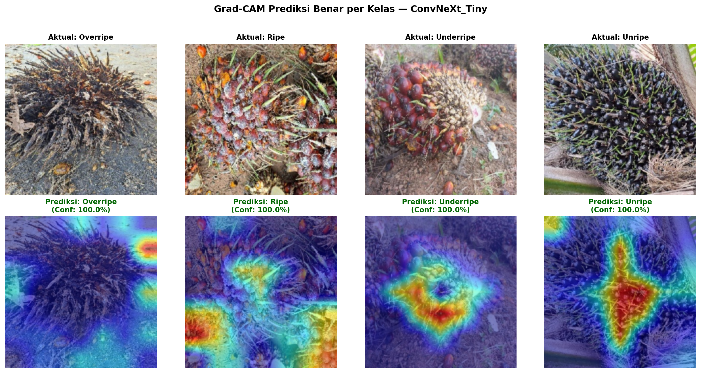
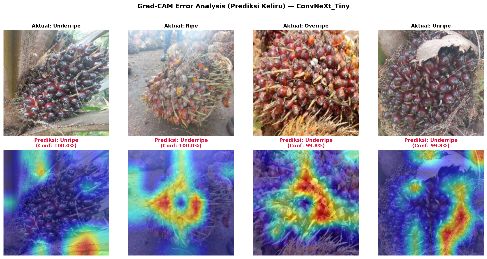

<div align="center">
  

  # 🌴 Nyawit: Oil Palm Fruit Ripeness Classification
  **End-to-End Deep Learning Benchmarking & Explainable AI (Grad-CAM) for Oil Palm Fresh Fruit Bunches**

  [-6706CE?style=for-the-badge&logo=roboflow&logoColor=white)](https://universe.roboflow.com/data-fyp-1/oil-palm-fruit-zohnc)
  [](LICENSE)

  <br/>

  
  
  
  
  
  
</div>

---

## 📖 Overview

Automated ripeness grading of **Oil Palm Fresh Fruit Bunches (FFB / *Tandan Buah Segar*)** is critical in palm oil harvesting to maximize crude palm oil (CPO) extraction rates. This project implements a reproducible **6-stage Deep Learning pipeline** comparing a scratch-built **Custom CNN** against four pre-trained CNN architectures (**ConvNeXt-Tiny, DenseNet121, MobileNetV3-Large, and ResNet50**) across four ripeness classes:

* 🌑 **`Unripe` (*Mentah / Fraksi 0*):** Dark purple/black fruitlets tightly attached to the bunch.
* 🌗 **`Underripe` (*Mengkal / Fraksi 1*):** Transitional stage with reddish-orange tips and dark bases.
* 🍊 **`Ripe` (*Matang / Ideal Harvest*):** Bright reddish-orange fruitlets with natural fruit detachment.
* 🟤 **`Overripe` (*Terlalu Matang*):** Dull dark red/brownish fruitlets with empty sockets from fallen fruits.

---

## 🗂️ Dataset & Anti-Leakage Verification

The dataset is directly fetched via the Roboflow API from **[Oil palm fruit Computer Vision Dataset (v2)](https://universe.roboflow.com/data-fyp-1/oil-palm-fruit-zohnc)**, consisting of **4,727 real-world plantation images** (`640×640` resized to `224×224`).

* **Zero Data Leakage:** Audited using cryptographic **MD5 hashing** across `train`, `valid`, and `test` splits (**0 corrupt files** and **0 cross-split duplicates**).
* **Domain-Specific Augmentation:** Applied *on-the-fly* only to the `train` set (`RandomResizedCrop`, `Horizontal/Vertical Flip`, `Rotation ±25°`, and mild brightness/contrast jitter with **`hue=0.0`** locked to prevent color distortion).
* **Class Imbalance Handling:** Computed balanced class weights (`Unripe: 1.6742`, `Overripe: 1.1344`, `Underripe: 0.7976`, `Ripe: 0.7891`) for `CrossEntropyLoss`.

| Split | Unripe | Underripe | Ripe | Overripe | Total Images |
| :--- | :---: | :---: | :---: | :---: | :---: |
| **Train (50%)** | 353 | 741 | 749 | 521 | **2,364** |
| **Valid (30%)** | 192 | 406 | 479 | 342 | **1,419** |
| **Test (20%)** | 137 | 298 | 285 | 224 | **944** |
| **Total** | **682 (14.43%)** | **1,445 (30.57%)** | **1,513 (32.01%)** | **1,087 (23.00%)** | **4,727** |

---

## 🏆 Model Benchmark Results (Test Set: 944 Images)

All models were trained for 20 epochs on an **NVIDIA Tesla T4 GPU** using `AdamW` + `CosineAnnealingLR` + `ModelCheckpoint` (best Validation Macro F1-Score):

| Rank | Model Architecture | Test Acc (%) | Macro Precision | Macro Recall | Macro F1 | ROC-AUC | Params (M) | Size (MB) | Train (s/epoch) | Infer (ms/img) |
| :---: | :--- | :---: | :---: | :---: | :---: | :---: | :---: | :---: | :---: | :---: |
| 🥇 | **ConvNeXt_Tiny** | **94.60%** | **0.9486** | **0.9511** | **0.9498** | **0.9938** | 27.82 | 106.21 | 68.5 | 6.99 |
| 🥈 | **DenseNet121** | 92.16% | 0.9284 | 0.9311 | 0.9296 | 0.9881 | 6.96 | 27.13 | 38.0 | 7.09 |
| 🥉 | **MobileNetV3_Large** | 91.95% | 0.9248 | 0.9282 | 0.9264 | 0.9872 | **4.21** | **16.25** | **30.6** | **6.75** |
| 4 | **ResNet50** | 89.41% | 0.9007 | 0.9094 | 0.9044 | 0.9819 | 23.52 | 90.01 | 39.1 | 8.29 |
| 5 | **Custom_CNN_Baseline** | 82.10% | 0.8239 | 0.8358 | 0.8281 | 0.9613 | 0.42 | 1.63 | 30.0 | 11.91 |

<details>
<summary><b>📊 Click to Expand: Per-Class Classification Report (Best Model — ConvNeXt_Tiny)</b></summary>
<br/>

| Class | Precision | Recall | F1-Score | Support |
| :--- | :---: | :---: | :---: | :---: |
| **Overripe** | 0.9648 | 0.9777 | 0.9712 | 224 |
| **Ripe** | 0.9496 | 0.9263 | 0.9378 | 285 |
| **Underripe** | 0.9233 | 0.9295 | 0.9264 | 298 |
| **Unripe** | 0.9568 | 0.9708 | 0.9638 | 137 |
| **Macro Avg** | **0.9486** | **0.9511** | **0.9498** | **944** |
| **Weighted Avg** | **0.9460** | **0.9460** | **0.9459** | **944** |

</details>

<details>
<summary><b>⚙️ Click to Expand: End-to-End 6-Stage Pipeline Architecture</b></summary>
<br/>

1. **Pipeline 1 — Data Acquisition:** Automated download via Roboflow Python SDK (`folder` classification format).
2. **Pipeline 2 — Exploratory Data Analysis (EDA):** Class balance inspection, MD5 duplicate leak check, sample grid visualization, and RGB/HSV color intensity profiling.
3. **Pipeline 3 — Preprocessing & Augmentation:** ImageNet normalization (`mean=[0.485, 0.456, 0.406]`, `std=[0.229, 0.224, 0.225]`) + hue-preserving on-the-fly augmentation.
4. **Pipeline 4 — Controlled Model Training:** Scratch 4-block CNN vs. Hugging Face `timm` pre-trained models with weighted loss and cosine learning rate decay.
5. **Pipeline 5 — Quantitative Evaluation & Compute Profiling:** Learning curves, confusion matrices, multi-class ROC-AUC, parameter count, disk footprint, and GPU inference latency.
6. **Pipeline 6 — Explainable AI (Grad-CAM):** True-positive validation, error analysis, and cross-model attention comparison.

</details>

---

## 📈 Visual Diagnostics & Explainable AI (Grad-CAM)

### 1. Cross-Model Grad-CAM Focus Comparison (Test Sample `#500`)
On challenging plantation images containing background distractors (such as brown leather boots in the upper-right corner), **`ConvNeXt_Tiny`** and **`DenseNet121`** accurately lock onto the ripe orange-red fruitlets, whereas `Custom_CNN_Baseline` scatters attention onto the surrounding soil:

<p align="center">
  
</p>

<details>
<summary><b>🔍 Click to View More Visualizations (Learning Curves, Confusion Matrices, Compute Trade-Off & Error Analysis)</b></summary>
<br/>

#### Confusion Matrices Across All 5 Models
<p align="center">
  
</p>

#### Training & Validation Learning Curves (20 Epochs)
<p align="center">
  
</p>

#### Computational Cost & Efficiency Trade-Off
<p align="center">
  
</p>

#### Grad-CAM: True Positives vs. Error Analysis
<p align="center">
  
  
</p>

</details>

---

## 🚀 Quickstart

```bash
# 1. Clone this repository
git clone [https://github.com/sepuh-never-jp/Nyawit_oil_palm_ripeness_classification.git](https://github.com/sepuh-never-jp/Nyawit_oil_palm_ripeness_classification.git)
cd Nyawit_oil_palm_ripeness_classification

# 2. Install required libraries
pip install -r requirements.txt

# 3. Launch Jupyter Notebook / VS Code
jupyter notebook notebooks/nyawit.ipynb
```
> **Note:** Replace `"YOUR_API_KEY"` in **Pipeline 1** of `notebooks/nyawit.ipynb` with your free [Roboflow](https://roboflow.com/) API key to automatically download the dataset.

---

## 📜 License & Attribution

* **Code License:** Distributed under the **MIT License**. See [`LICENSE`](LICENSE) for more information.
* **Dataset Credit:** [**Oil palm fruit Computer Vision Dataset**](https://universe.roboflow.com/data-fyp-1/oil-palm-fruit-zohnc) by `data fyp 1` on Roboflow Universe, licensed under **CC BY 4.0**.
* **Pre-trained Backbones:** Loaded via [`timm`](https://github.com/huggingface/pytorch-image-models) from Hugging Face Hub.
